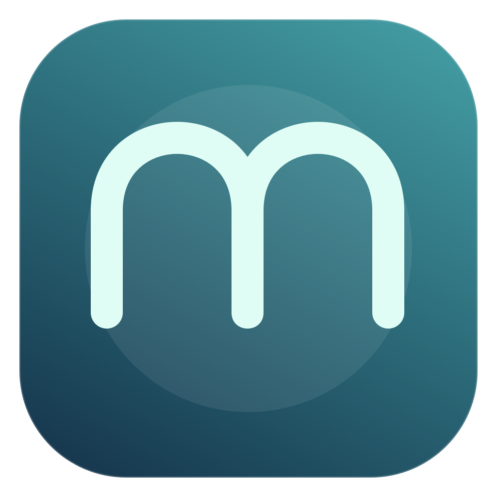

  
  <h1>macino</h1>
  
Everyday Mac tools. One place in your menu bar.

  
<strong>1.0.0 · Apple silicon · macOS 14+</strong>

  
<a href="https://github.com/ArianAtri/macino/releases">Downloads & releases</a> · <a href="docs/install.md">Install</a> · <a href="docs/guide.md">User guide</a>

macino brings system stats, process controls, clipboard history, quick shortcuts,
network tools, Android connections and an offline reader into one native Mac app.

## What you can do

- **System:** check CPU, GPU, memory, storage and supported temperature sensors.
  Choose which stats appear beside the menu bar icon.
- **Processes:** find, group and sort processes, then stop the ones your account
  can manage. Critical system processes stay protected.
- **Quick Access:** keep files and folders one click away.
- **Internet:** inspect network activity and manage supported DNS/proxy settings.
- **Android:** browse an MTP device and mirror its screen over USB or Wi-Fi with
  the bundled tools. Device setup and Android permissions still apply.
- **TV:** mirror the Mac display to compatible DLNA televisions on the same
  network, including non-Android smart TVs. FFmpeg is required; system audio
  also needs an optional loopback audio device.
- **Reader:** listen to mixed Persian and English text offline. Type or paste,
  or open TXT, text PDF, DOCX and DOC files. Follow sentence highlights and adjust
  the speed. Scanned documents and OCR aren’t supported.
- **Clipboard:** optionally remember your last 50 copied texts. Open a small
  searchable list with **⌃V**, or record your own shortcut. Copy/paste an item,
  delete one, clear the list, or drag the popup by its edges.

## Install

1. Download the Apple-silicon DMG from a release.
2. Open it and drag **macino.app** into **Applications**.
3. Open macino from Applications. Its icon appears in the menu bar.

Quit macino before replacing an older copy. Launch at login is optional and can be
changed in Settings. See the [installation guide](docs/install.md) if macOS blocks
opening the app.

**This release is locally signed, not Developer ID signed or notarized.**
macOS may warn when you open a downloaded copy. Only install a copy you trust.
The release targets Apple silicon; Intel binaries are not provided. Runtime
compatibility on every supported macOS version and chip has not been verified.

## Your text stays on your Mac

Clipboard history is off by default and stays in memory. Turning it off or
quitting clears the history. Reader speech runs locally; voice models load for
playback in child processes and are released when those processes exit.
Accessibility is optional for ordinary clipboard shortcuts; it enables cursor
positioning and automatic pasting. [Privacy & permissions](docs/privacy.md)
explains the details, including network tools and Android connections.

## Help and development

- [User guide](docs/guide.md) · [Troubleshooting](docs/troubleshooting.md)
- [Changes](CHANGELOG.md) · [Build from source](docs/development.md)
- [Report a bug](https://github.com/ArianAtri/macino/issues/new/choose)
- [Contributing](CONTRIBUTING.md) · [Security](SECURITY.md)

Created by **[Arian Atri](https://github.com/ArianAtri)**.

No general open-source license has been granted for macino’s original source yet.
Bundled dependencies have their own licenses and notices in `Resources` and the
built application. See [third-party components](docs/third-party.md).
